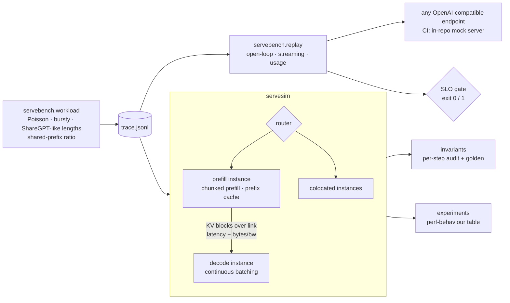

# llm-serving-validation

Validation for the parts of an LLM serving engine that break quietly: prefill/decode disaggregation, the paged KV cache, prefix caching, and continuous batching.
There are two halves. **`servesim/`** is a deterministic discrete-event model of a serving engine (vLLM-v1-shaped scheduler, paged KV with ref-counted shared blocks, hash-chained prefix cache, LRU eviction, recompute/swap preemption, a KV-transfer link). It is faithful enough that real invariants can be tested against it, and three realistic engine bugs are seeded behind version flags to show the suite catches them.
**`servebench/`** is a workload generator plus an open-loop replay client for **any** OpenAI-compatible endpoint (vLLM, SGLang, TRT-LLM). It measures TTFT / ITL / TPOT / throughput / goodput and gates on an SLO file.

The trick that makes the correctness tests real: the simulated "model" emits tokens from the KV state it **reads through the block table**, and an engine-free golden computes the same thing straight through. A wrong block (prefix collision, use-after-free, dropped chunk) changes the output, so "a prefix-cache hit returns the same output as a cold run" is a real check, not a tautology.



## What's covered

### Correctness invariants (clean release, 11 scenarios × every invariant)

| Property | Test |
|---|---|
| No KV block leaks once every request finished or aborted; no CPU swap-slot leaks | `test_scenario_holds_every_invariant` |
| Every block's ref count equals the number of block tables holding it, **checked every step** | per-step audit in `invariants.audit_step` |
| Ref counts never go negative; a referenced block is never handed out again | allocator violations, `test_double_free_is_recorded_as_negative_refcount` |
| A prefix-cache hit returns the same tokens as a cold run | `test_prefix_hit_returns_same_output_as_cold_run` |
| Preemption (recompute **and** swap) never loses or duplicates a token | `test_preemption_never_loses_or_duplicates_tokens` |
| The scheduler never exceeds `max_num_batched_tokens`, `max_num_seqs`, or the block pool | `test_step_budget_and_batch_cap_never_exceeded` |
| Aborts free blocks wherever they land: waiting, running, swapped, queued for transfer, **mid-transfer** | `test_aborts_cover_queue_states_and_free_blocks`, `test_abort_during_kv_transfer_frees_both_sides` |
| KV copied prefill → decode decodes to the same tokens as colocated | `test_disaggregated_outputs_match_golden_after_transfer` |
| A full decode pool back-pressures transfers instead of dropping requests | `test_decode_backpressure_holds_prefill_blocks_not_drops_requests` |
| Pressure scenarios really preempt and really hit the cache (no vacuous pass) | `test_pressure_scenarios_actually_preempt`, `test_prefix_cache_actually_hits` |

### Performance behaviour, with explicit expectations

From `python -m servesim experiments` (deterministic; the tests assert ratios, not snapshots):

| Experiment | Variant | TTFT p50 ms | ITL p99 ms | ITL max ms | out tok/s | preempt |
|---|---|---|---|---|---|---|
| disaggregation (prefill-heavy, 2 GPUs each) | colocated ×2 | 54.8 | 50.9 | 67.0 | 661 | 0 |
| | disagg 1P+1D | 71.0 | **6.0** | 11.4 | 661 | 0 |
| KV link | 50 GB/s | 71.0 | 6.0 | 11.4 | 661 | 0 |
| | 1 GB/s | **6293** | 5.5 | 10.9 | 443 | 3 |
| prefix caching (90% share a 1024-tok system prompt) | off | 40.5 | 37.2 | 67.0 | 1014 | 0 |
| | on | **8.4** | 6.0 | 36.5 | 1016 | 0 |
| head-of-line (3 × 8k prompts in decode traffic) | no chunked prefill | 13.2 | 13.0 | **246** | 1923 | 0 |
| | chunked, 512 budget | 13.7 | 20.6 | 20.7 | 1923 | 0 |
| KV pressure | 4096 blocks | 18.1 | 20.0 | 34.9 | 3440 | 0 |
| | 512 blocks | 2175 | 26.5 | 1078 | 2356 | **80** |
| | 512 blocks, 20% watermark | 2785 | 19.9 | 1020 | 2205 | 5 |
| continuous batching | max_num_seqs 1 / 8 / 64 | — | — | — | 198 / 1407 / 5292 | 0 |

| Expectation | Test |
|---|---|
| Disaggregation cuts ITL p99 ≥3× under a prefill-heavy mix | `test_disaggregation_cuts_itl_p99_under_prefill_heavy_load` |
| …and is not free: TTFT is worse (one prefill GPU + the KV hop) at equal throughput | `test_disaggregation_is_not_free_ttft_pays_for_transfer_and_one_prefill_gpu` |
| A slow KV link makes transfer the TTFT bottleneck | `test_slow_kv_link_makes_transfer_the_ttft_bottleneck` |
| Prefix caching halves TTFT p50 and p99 on shared system prompts | `test_prefix_caching_cuts_ttft_on_shared_system_prompts` |
| Without chunked prefill, one long prompt stalls every decode (>200 ms ITL) | `test_long_prompt_without_chunked_prefill_stalls_every_decode` |
| Chunked prefill's own cost (higher ITL p99 floor) is visible too | `test_chunked_prefill_trades_a_higher_itl_floor_for_no_stalls` |
| KV pressure shows up as a preemption storm: preemptions, ITL max, throughput | `test_kv_pressure_shows_up_as_a_preemption_storm` |
| An admission watermark damps the storm at a TTFT cost | `test_admission_watermark_damps_the_storm_at_a_ttft_cost` |
| Continuous batching scales throughput with batch size | `test_continuous_batching_scales_throughput_with_batch_size` |

## Seeded engine bugs

[`servesim/versions.py`](servesim/versions.py) has five releases; three carry one realistic bug each. `python -m servesim qualify --version <v>` runs every scenario and exits 1 on any violation.

| Version | Bug | Caught by | Why a simpler check misses it |
|---|---|---|---|
| 1.5.0-rc1 | Block hash ignores the parent hash, so an identical 16-token block at a different position reuses KV computed under a different prefix | `output_mismatch` on the RAG workload where a document appears at position 0 in some requests and after a system prompt in others | Ordinary shared-system-prompt traffic always starts at position 0 and never collides (`test_prefix_hash_bug_passes_ordinary_shared_prefix_traffic`). No crash, no leak, right token count: a silent wrong answer |
| 1.5.0-rc2 | Swap-out keeps shared prefix blocks resident but drops the preempted sequence's reference, so the block can be evicted and reused under it | per-step `refcount_mismatch` (the step it happens), then `refcount_negative`, `block_leak`, `output_mismatch` | Needs prefix sharing **and** swap preemption; recompute mode or no prefix cache never takes the path |
| 1.5.0-rc3 | Chunked-prefill chunk = remaining budget + 1 | `budget_exceeded` (step of 257 on a 256 budget) | Outputs are correct. In a real engine it overflows buffers sized for `max_num_batched_tokens` or misses the CUDA-graph bucket |

## Run it

```bash
python3 -m venv .venv && .venv/bin/pip install -r requirements.txt
.venv/bin/python -m pytest                                  # 78 tests, ~30s
.venv/bin/python -m servesim qualify --version 1.5.0-rc2    # NO-GO, exit 1
.venv/bin/python -m servesim experiments --md reports/sim.md
```

Benchmark any OpenAI-compatible endpoint:

```bash
.venv/bin/python -m servebench gen --n 200 --rate 8 --arrival bursty --shared-prefix-ratio 0.6 --prefix-tokens 512 --out trace.jsonl
.venv/bin/python -m servebench run --base-url http://localhost:8000/v1 --model meta-llama/Llama-3.1-8B-Instruct \
    --trace trace.jsonl --slo slo/llama3-8b-h100.json --out reports/bench.json --summary-md reports/bench.md
```

`run` is open-loop (requests go out at their trace times regardless of earlier ones), streams with `stream_options.include_usage`, sends `ignore_eos` so output lengths match the trace (`--no-ignore-eos` for servers that reject it), and measures TTFT from the *scheduled* arrival so client queueing and 429 back-off count. It exits 1 when the SLO gate fails. `python -m servebench mock` starts the in-repo mock server.

## CI

[`ci.yml`](.github/workflows/ci.yml): the test suite; qualification of every engine version (clean releases must be GO, seeded ones NO-GO); and a replay benchmark against the mock server gated by `slo/mock.json`. The simulator experiment table and the benchmark table are posted to the job summary.

## Layout

```
servesim/     kv_cache (paged blocks, prefix cache, LRU, swap space) · engine (scheduler, preemption, roles)
              cluster (event loop, router, KV link, aborts) · model (KV-reading token model + golden)
              invariants · scenarios · experiments · versions (seeded bugs) · CLI
servebench/   workload (arrivals, lengths, prefix groups) · metrics (shared with servesim) · replay (client)
              gate (SLO file) · mockserver (OpenAI-compatible SSE) · CLI
tests/        unit/ · sim/ (invariants, seeded bugs, performance) · bench/ (replay vs in-process mock)
slo/ traces/  SLO gates and sample traces
docs/         SERVING_TEST_STRATEGY.md
```

## Where this stops

- **No GPU ran here.** `servesim` is a model: the cost model is loosely calibrated to an 8B model on one H100 (weight-read-bound decode, compute-bound prefill, 128 KiB KV/token), and the numbers above are the model's numbers, not measurements. The invariants and the *direction* of each performance effect are what transfer; absolute milliseconds do not.
- The simulator has no attention kernels, CUDA graphs, tensor/pipeline parallelism, speculative decoding, or real KV connectors (NIXL, Mooncake, LMCache). The KV link is `latency + bytes/bandwidth`, FIFO per prefill instance.
- `servebench` is real code that speaks the real protocol, but in this repo it has only been run against the in-repo mock, which is a timing fixture (fixed TTFT/ITL, toy prefix cache), not a performance model. Against a real engine, first take a baseline and set `slo/` from it.
- Prompts are synthetic words, so the server's token count drifts from the trace's (reported via `usage.prompt_tokens`). For exact lengths, replay pre-tokenized prompts.
